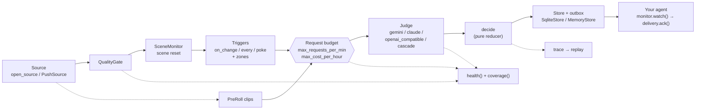

# Percept

**Percept watches a live video stream for plain-language conditions and tells your agent, once per
occurrence, when one becomes true.**

> **Status: 0.9.0 Developer Preview.** The API may change before 1.0.

## Who it is for

- **For** developers building agents that must react to what fixed cameras see: a door left open,
  a person who falls, a package on a loading dock.
- **Not for** moving or non-camera video: PTZ, body-worn, vehicle, drone or phone video, or screen
  content.

Percept decides *when* it is worth asking a model, *what* is true, and *whether* your agent should
hear about it. It doesn't replace your models, your cameras or your agent.

## Install

```bash
pip install "percept-vision[video,gemini]"
```

Extras: `video` (OpenCV, for cameras and files), and one per judge: `gemini`, `claude`, `openai`
(OpenAI and OpenAI-compatible local servers). `import percept` needs none of them.

From a checkout of this repository:

```bash
python -m venv .venv && . .venv/bin/activate
pip install -e "packages/percept-vision[video,gemini]"
```

## A 60-second offline demo

No camera, key or network: a synthetic scene and a scripted judge.

```bash
python examples/quickstart.py
```

```text
percept.MemoryStore keeps decisions in memory only: delivery is not crash-safe
met        box_in_zone   a red box sits in the zone  (confidence 0.95)
cleared    box_in_zone   the zone is empty  (confidence 0.90)
uncertain  package_fell  the verifier could not tell from the original evidence  (first look's confidence 0.80)

coverage: what was looked at, and what came of each look
  box_in_zone   looked at 8 times; 0 of those looks couldn't tell
  package_fell  looked at 2 times; 1 of those looks couldn't tell
  time when nothing could be seen or judged: 0 intervals

replay: 3 decisions from 10 inputs reproduced exactly
```

The first line is expected: the demo keeps decisions in memory, and `MemoryStore` says once that
this is not crash-safe. A real monitor uses the default SQLite store.

## Watch a camera

```python
import asyncio

import percept


async def handle(decision: percept.Decision) -> None:
    # Your agent acts here. A decision can be delivered more than once: deduplicate on decision_id.
    print(decision.type, decision.condition_id, decision.reason, decision.decision_id)


async def main() -> None:
    monitor = percept.Monitor(
        judge=percept.judges.gemini("gemini-2.5-flash"),    # reads GEMINI_API_KEY
        conditions=[
            percept.Condition("door_open", "the garage door is open", emit_cleared=True),
            percept.Condition("fall", "a person falls to the floor", kind="event"),
        ],
    )
    async with monitor:
        source = percept.open_source("rtsp://camera.local/stream", fps=5)
        async for delivery in monitor.watch(source, ack="manual"):
            await handle(delivery.decision)
            await delivery.ack()        # unacknowledged decisions are delivered again after a restart


if __name__ == "__main__":
    asyncio.run(main())
```

Each decision has a `type` (`met`, `uncertain`, `cleared` or `expired`), a stable `decision_id`,
the `occurrence_id` it belongs to, a machine-readable `cause`, a `reason` for people, a
`confidence`, the time the evidence shows it (`t_observed`), its `cost` and a keyframe. See
[docs/delivery.md](docs/delivery.md#the-decision-contract).

## Architecture



Every stream runs **Trigger → Judge → Decide**. Frames pass a quality gate (corrupt or blurry
frames are dropped) and a scene check (a bumped camera or a day/night switch is a scene reset,
never an event). Cheap triggers then decide when a condition is worth a look: a change inside
its zone, a heartbeat, or a poke from your own code. Looks go to the judge, a vision-language
model behind one interface, under a hard per-stream request budget and an optional cost cap; it
answers yes, no or unknown with a confidence. A pure reducer turns those answers into at most one
`met` per real occurrence (events are verified a second time on the same frames), and each
decision is stored before it is delivered, until your agent acknowledges it. Everything Percept
could not see or judge is reported on `health()` and `coverage()`, and a trace replays every
decision without the video or the judge. More in [docs/concepts.md](docs/concepts.md).

## Limits

- **Static cameras only.** A moving camera looks like a constant scene change.
- **Thresholds and defaults are starting points, not calibrated values.** Confidence is the
  judge's and is advisory.
- **A judge failure is never an answer.** A timeout, outage, refusal or malformed reply changes no
  decision; it is reported on `health()` and `coverage()`.
- **Known limitation: small, distant or brief activity in busy surveillance scenes is often
  missed**, because the change trigger does not fire on it and the judge is never asked. Pair
  such conditions with a heartbeat (`every`), a tighter zone, or a lower `on_change` threshold,
  and check `coverage()`. See [docs/concepts.md](docs/concepts.md#known-limitation-small-distant-or-brief-activity).
- **Slow providers can time out.** Each judge request has an 8 s deadline; sparse requests to a
  slow provider can exceed it and are reported as failures.
- **No performance numbers are published for this release.** Semantic accuracy depends on the
  judge and the condition wording, and Percept can't guarantee it.

What this release assumes, in full: [docs/concepts.md](docs/concepts.md#what-this-release-assumes).

## Documentation

| Page | |
|---|---|
| [docs/quickstart.md](docs/quickstart.md) | install, the offline demo, a first camera |
| [docs/concepts.md](docs/concepts.md) | Trigger → Judge → Decide, states and events, occurrences, coverage |
| [docs/conditions.md](docs/conditions.md) | every `Condition` field, its default and how to tune it |
| [docs/judges.md](docs/judges.md) | Gemini, Claude, OpenAI-compatible, cascades, prices and budgets |
| [docs/sources.md](docs/sources.md) | `open_source`, push sources, `set_link`, the static-camera assumption |
| [docs/delivery.md](docs/delivery.md) | the decision contract, acknowledgement, stores, health, trace and replay |
| [docs/decision-semantics.md](docs/decision-semantics.md) | the exact decision rules |

- [examples/](examples/): the offline quickstart, Frigate person events, a kitchen state on a
  heartbeat. All run offline with no arguments.
- [benchmarks/](benchmarks/README.md): the reproducible benchmark harness and its methodology.

## Contributing

See [CONTRIBUTING.md](CONTRIBUTING.md) and [AGENTS.md](AGENTS.md). Security reports:
[SECURITY.md](SECURITY.md).

## Support

Questions and bug reports: open an issue at https://github.com/REPLACE-ME/percept/issues, or email
support@velvee.ai.

---

Percept is developed by Velvee, Inc. Licensed under Apache-2.0.
