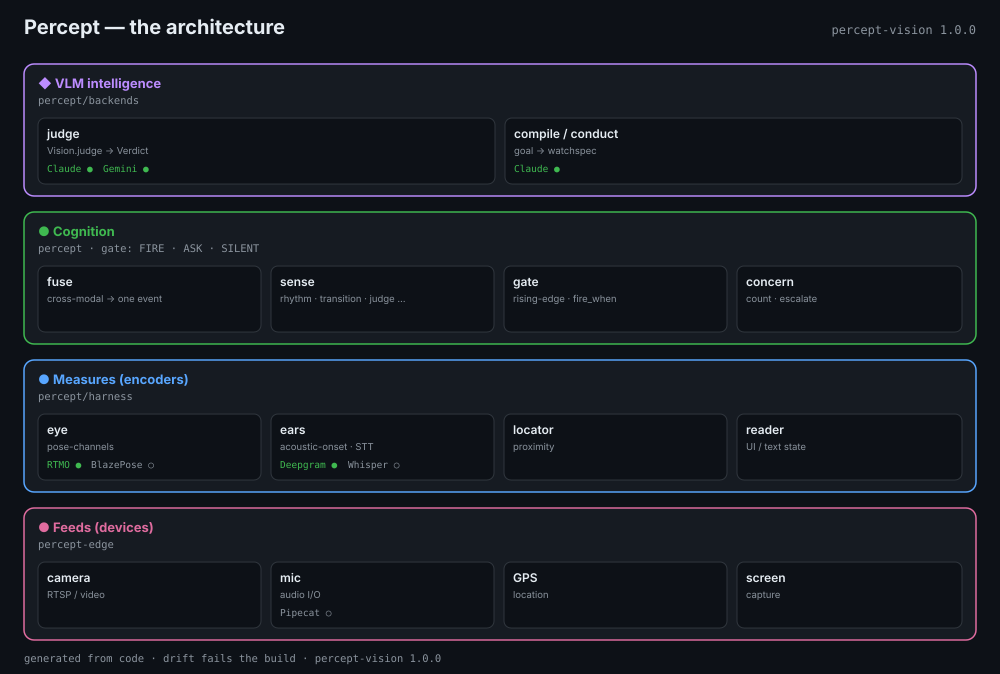

# percept

The open-source **cognition layer** for goal-driven, proactive vision agents.

> **⚠️ Research preview — v0.6.0.** Published for real-life testing and feedback, **not** for
> production. The cognition core (gate, entity graph, executor, events, scheduler, consent) runs and is
> tested offline with fakes. APIs may change between `0.6.x` releases — pin a version. No benchmark
> numbers are published yet (see [Benchmark status](#benchmark-status)). Issues and feedback welcome.

You state a goal in plain language — *"nudge me when I drink a coffee"*, *"tell me when the kettle
boils"* — and percept turns a live audio-visual stream into an agent that **reasons over entities
across time**, **fires only on the rising edge** of a condition becoming true, and **refuses to
guess** — a three-state gate maps *known → act · not → silent · unknown → ask*.

The wedge is **temporal cognition** — entity memory + the three-state gate + reasoning over events —
which a raw VLM-in-a-loop and a per-frame pipeline both lack. percept builds on frontier models for
perception behind vendor-neutral seams, and keeps the cheap stateful brain in the loop the whole time.

## Install

```bash
pip install percept-vision        # core: PURE STDLIB — runs offline with fake backends, no keys
```

**The package is `percept-vision`; the import is `import percept`.** (Name ≠ import — say it out loud.)
The core has **zero dependencies** and runs with deterministic fake backends, so `pip install` then run
works with no API keys. Python **≥ 3.10**. Frontier backends are opt-in extras:

```bash
pip install "percept-vision[gemini]"     # GeminiVision
pip install "percept-vision[claude]"     # AnthropicVision (Claude)
pip install "percept-vision[deepgram]"   # Deepgram STT + TTS (voice)
pip install "percept-vision[runtime]"    # camera/video/RTSP runtime worker
pip install "percept-vision[bench]"      # benchmark + scorecard tooling
pip install "percept-vision[edge]"       # Python tier-0 gate + detector registry
pip install "percept-vision[all]"        # everything
```

## 60-second quickstart (no keys)

Fully offline — fake backends, deterministic, nothing to configure. This script runs **as-is**:

```python
import asyncio
from percept import Percept, Goal

async def main():
    # Fake backends by default — offline, no keys. discover_plugins=False skips plugin lookup.
    agent = Percept.create(discover_plugins=False)

    agent.add_goal(Goal(
        id="caffeine",
        condition="the user is drinking coffee",
        say="Heads up — stepping back from caffeine?",
    ))

    # Each frame is judged; the gate fires ONCE on the rising edge.
    # ("sip-coffee" is a token the fake vision backend scripts as a confident YES.)
    fires = await agent.perceive_judged("sip-coffee")
    for ev in fires:                       # ev is a FireEvent
        print(ev.action, ev.goal_id, ev.text)   # -> fire caffeine Heads up — stepping back from caffeine?

    # The same frame again does NOT re-fire — rising-edge, not level-triggered.
    print(await agent.perceive_judged("sip-coffee"))   # -> []

asyncio.run(main())
```

`perceive_judged(frame)` returns a list of `FireEvent(goal_id, action, text, entity_id, verdict)`,
where `action` is `"fire"` or `"ask"`. Swap the fake for real eyes — the cognition layer is unchanged:

```python
agent = Percept.create(vision="gemini")          # needs percept-vision[gemini] + GEMINI_API_KEY
```

Backends are selected by name (`"fake"` · `"gemini"` · `"claude"`), by adapter instance, or by env
(`PERCEPT_VISION_BACKEND`). Canonical examples are **key-free by default** (fake backend); the live ones
print a one-line instruction when a key is missing — never a stack trace. See
[`examples/`](examples/) (start with [`examples/watch_agent.py`](examples/watch_agent.py)).

## Architecture

The diagram below is **generated from the code** by
[`tools/build_architecture.py`](tools/build_architecture.py) — a stale code-pointer or a false
integration marker fails the build, so the picture can never drift from what ships.



*Interactive version: [`architecture.html`](architecture.html) · the prose map:
[`docs/explanation/architecture.md`](docs/explanation/architecture.md).*

Four tiers, signal flowing up: **Feeds** (`percept-edge` devices) → **Measures** (`percept.harness`
detectors/pose) → **Cognition / System 1** (`percept` — senses · the three-state gate · concern; cheap,
deterministic, *always in the loop*) → **VLM / System 2** (`percept.backends` — summoned behind
vendor-neutral registry seams, paid per call). A raw VLM-in-a-loop collapses System 1 and System 2 into
one expensive call every frame; percept keeps them apart so the common case costs nothing.

## The envelope (refusals, stated proudly)

- **Assistant-class, never the safety mechanism.** percept informs a human who stays responsible. It is
  never the thing standing between a person and harm on a clock it can't guarantee. *Out:*
  driver-drowsiness intervention. *In:* a post-hoc driving debrief.
- **Watches the user's own world, with the user as beneficiary** — never a non-consenting third party to
  the wearer's advantage. *Out:* covert analysis of someone you're negotiating with; card-counting
  against a live casino. *In:* a play-money practice trainer.

These refusals are a feature. **Do not lead with surveillance demos.**

## Packages

| package | what | install |
|---|---|---|
| **percept-vision** | the Python SDK: cognition core, fakes, runtime worker, Python edge/harness, benchmark tooling (extras). | `pip install percept-vision` |
| **percept-edge** | on-device reactive edge in JS/WASM: VAD + motion gate over the same WatchSpec/Tier0Signal wire-contract. | `npm install percept-edge` |

The tier-0 edge harness and the frozen wire-contract are bundled inside `percept-vision` as the
`percept.harness` and `percept.contracts` subpackages — so OSS users install **one** Python package
(heavy deps are opt-in extras) plus the optional npm edge package.

> **Versioning.** The package version is `percept-vision 0.6.0` (research preview). The **wire-contract**
> version is separate — `CONTRACT_VERSION = "1.2.0"` (additive-only). A `0.6.0` install exporting
> contract `1.2.0` is expected, not a bug.

## Benchmark status

**No Percept accuracy numbers are published yet.** The benchmark is designed but the reproducible
model-sweep run is a separate, later phase. What exists today is the *methodology* and the *runbook*:
[`docs/reference/benchmark-methodology.md`](docs/reference/benchmark-methodology.md) and
[`docs/reference/publishable-benchmark.md`](docs/reference/publishable-benchmark.md). Figures in those
docs are external reference bars or illustrative examples — not Percept claims. The benchmark harness
and the golden set are **repo/dev tooling, not packaged in the wheel** (the wheel is just `import
percept`), so benchmark commands run from a source checkout:

```bash
# from a repo checkout (the [bench] extra installs numpy/opencv; --manifest can be your own clips):
pip install -e "packages/percept-vision[bench]"
PYTHONPATH=packages/percept-vision percept-bench scorecard \
    --manifest eval/golden-v1/MANIFEST.json --out out/scorecard.txt
```

## Docs

Full index: **[`docs/README.md`](docs/README.md)** (organized by Diátaxis). Highlights:

- **New here?** [`docs/tutorials/choose-your-path.md`](docs/tutorials/choose-your-path.md) — the narrow
  first path (pick one row, ignore the rest).
- **Quickstart** — [`docs/tutorials/quickstart.md`](docs/tutorials/quickstart.md) (the snippet above).
- **Architecture** — [`docs/explanation/architecture.md`](docs/explanation/architecture.md): the four
  tiers, the two-layer brain, the firing paths — every claim anchored to code. Then
  [`docs/explanation/concepts.md`](docs/explanation/concepts.md) (the cognition/perception split) and
  [`docs/explanation/e2e-flow-milk-boilover.md`](docs/explanation/e2e-flow-milk-boilover.md) (a worked
  judged flow).
- **Runtime** — [`docs/how-to/runtime.md`](docs/how-to/runtime.md): `run(source) → incidents`.
- **Backends** — [`docs/reference/backends.md`](docs/reference/backends.md): the five seams and how to
  add one.
- **Audio modality** — [`docs/reference/audio-modality.md`](docs/reference/audio-modality.md).
- **Edge parity** — [`docs/reference/edge-parity.md`](docs/reference/edge-parity.md).
- **Evaluate your own concerns** — [`docs/how-to/eval.md`](docs/how-to/eval.md): per-concern
  precision/recall from a labelled-clip manifest, offline (`make eval-benchmark`), with a CI
  regression-gate template ([`examples/benchmark/`](examples/benchmark/)).
- **AI-agent map** — [`llms.txt`](llms.txt) and [`AGENTS.md`](AGENTS.md).

## Layout

```
packages/percept-vision/    the SDK (pip install percept-vision; import percept)
                            ├─ percept.harness    bundled Python tier-0 edge + detector skills
                            └─ percept.contracts  bundled frozen wire-contract (DTOs + Protocols)
packages/percept-edge/      percept-edge — on-device JS/WASM edge (npm)
docs/                       Diátaxis docs + the generated architecture.svg
eval/                       golden corpus (benchmark plan: packages/percept-vision/eval/)
examples/                   runnable example agents (fake-backed by default)
tools/build_architecture.py the architecture-diagram generator
Makefile                    test · parity · architecture · check · eval-live · e2e
```

## Status

**v0.6.0 — research preview.** The cognition core runs and is tested offline with fakes (the L1 lane,
no keys); the frontier backends (Gemini, Claude, Deepgram) and the edge packages are wired behind their
seams. No benchmark numbers are published yet. We are in **real-life testing** — APIs may change.
Issues and contributions welcome ([CONTRIBUTING.md](CONTRIBUTING.md)).

## License

Apache-2.0.
